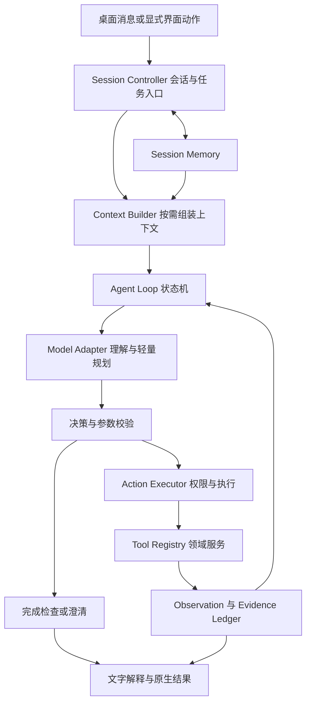
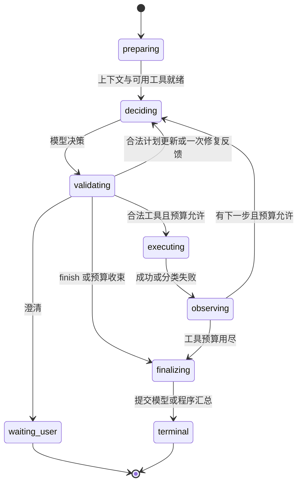

# Companion Agent 运行架构设计

> 设计基线：2026-09-05。状态：设计收口，分阶段待实现。
> 2026-09-06 更新：D2a1 循环预算与停止（9.3 预算、9.4 finalize 收束、统一取消、一次终态）已在本仓完成主管验收；下文其余部分（v2 控制协议、会话、证据账本、渐进规划、重复检测）仍然只是设计，不代表已经交付。
> 范围：Planning、Memory、Tool Use、Action、Agent Loop，以及它们依赖的上下文、证据、模型适配、事件和评估。产品边界见 [PRODUCT.md](PRODUCT.md)，切片排期见 [DEVELOPMENT_PLAN.md](DEVELOPMENT_PLAN.md)。

## 1. 设计结论

保留 TypeScript 自有 Harness、单 Agent、类型化领域工具和 React 原生结果组件。采用**受预算约束的状态机循环 + 按需轻量规划 + 会话状态 + 跨步骤证据记录**。模型负责提出可检查的决策；Harness 是任务状态的唯一写入者，负责验证、执行、记录和停止。

简单问价不增加独立规划调用；复合任务由同一个模型按需建立短计划，再根据观察调整。当前不引入独立 Planner/Executor Agent、常驻 Reflection 模型、向量数据库、通用代码执行或新的框架依赖。需要持久恢复或复杂分支时再评估框架迁移，而非把迁移当作本设计的前置。

本文中的参数是待验证的项目初始配置，不是行业通用默认值。15 次工具预算来自维护者决定；其余预算须在落地时记录实际模型与延迟表现。

## 2. 现状与问题：以源码为准

| 范围 | 现有行为 | 设计要解决的问题 |
|---|---|---|
| 决策循环 | `runDesktopAgent` 接收模型工具决策，最多 15 次；每轮只支持一个调用 | 第 15 次结果后直接固定收尾，没有最终模型汇总机会 |
| 任务完成 | 使用 `lastOk`、最后一份回答和模型终态 | 查询成功不等于全部目标解决；成功但不相关的数据也可能不足 |
| 证据 | `facts` 在每次工具执行后重赋值 | 多物品、多数据源的前序证据丢失，错误分支也可能覆盖已有事实 |
| 会话 | renderer 保留消息，模型输入是本条消息和本次工具历史 | 下一条消息没有可靠的当前物品、用户目标和范围上下文 |
| 参数上下文 | `defaults` 传首轮，后续 `generateTurn` 未继续传 | 后续工具调用可能失去显式范围；不能靠模型自行猜回 |
| 工具后交互 | 工具后的 clarify 被视为非法终态；insufficient_data 只在最后工具失败时接受 | 无法自然处理查后歧义、部分完成和条件不足 |
| 时间 | renderer 固定 15 秒；runtime 默认 15 秒、最大 60 秒 | 放宽调用次数不等于有足够多步执行时间 |
| 取消 | 模型请求支持 signal，领域服务依赖接口未传 signal；健康检查未接入同一运行取消路径 | 停止等待不等于底层 I/O 已中止；超时和迟到结果需统一处理 |
| 流式文本 | 多轮共用 `streamedText`，模型文本可直接发往 UI | 中间文本、最终回答与错误回退缺少清楚的分段和提交边界 |
| Tool Use | Schema、白名单校验和个人工具执行点权限门禁已存在 | 保留基础，改为每轮提供实际可用工具和有来源的结构化观察 |

源码入口：`packages/agent-runtime/src/index.ts`、`openai-compatible.ts`、`apps/desktop/src/main.ts`、`renderer/App.tsx`。这些是代码审查发现，本次未做真实远程模型复现。

历史验收需要区分：AGENT_HARNESS 记录了 2026-08-19 的服务级真实模型冒烟；当前桌面构建及新循环设计没有真实远程模型验收。不能把历史成功扩大为当前桌面验收，也不能说整个项目从未做过真实模型测试。

## 3. 组件分工与数据流



| 组件 | 输入和输出 | 状态所有权 |
|---|---|---|
| Session Controller | 用户消息、可信窗口身份 → session/task/run 标识 | 会话归属、活动运行和修订号；驻 Electron 主进程 |
| Context Builder | 用户消息、任务、授权范围内的证据、工具目录 → 模型上下文 | 不修改业务状态；负责选取和裁剪 |
| Planning | 当前目标与观察 → 计划提案、下一动作或结束提案 | 模型只提案，Harness 校验后写入 TaskState |
| Memory | 明确用户条件、已校验实体与任务摘要 → 后续会话上下文 | 主进程单写；模型不得写身份、授权、预算或工具事实 |
| Tool Use | 工具描述、结构化调用、Observation | Registry 管合同，Adapter 管模型 wire 格式 |
| Action Executor | 已校验调用＋可信权限＋预算 → Observation | 执行前再授权，处理超时、错误及副作用边界 |
| Agent Loop | 上述组件协作 → 单一运行终态 | 唯一写入 TaskState、计数器、步骤记录的组件 |
| Evidence Ledger | 服务返回的规范事实 → 按实体/范围/时间可引用的证据 | append-only 记录，模型只能引用不能制造 |
| Presenter / Trace | 运行事件 → 用户结果／脱敏诊断 | 展示数据、模型视图和诊断分别投影 |

这些是代码边界，不需要各自成为服务、进程或 package。先在现有 runtime 内抽出模块，避免一次重写整个应用。

## 4. Planning：渐进规划与目标覆盖

### 4.1 三种流程

- **明确单项查询**：第一次模型决策即可发起工具调用；Harness 创建一个需求项，不要求额外 plan 调用。
- **复合查询**：例如“查价格和掉落来源”，同一模型先提交简短计划，下一轮执行工具；也可先查一个明确项，遇到组合需求再补计划。
- **条件决策**：例如“半小时内优先刷什么”，记录时间、目标、已有资源等限制。缺少会改变建议的条件时澄清；已实现的领域计算服务提供概率、成本和排序，模型解释取舍。

计划只列可观察的目标、依赖和缺口，不要求输出完整思维链。步骤不要预先填入尚未查询的库存、价格或完成结果。缺少的工具应形成 capability gap，不生成虚假的可执行步骤。

### 4.2 任务结构（目标接口，不是已发布类型）

```ts
type RequirementStatus = 'pending' | 'supported' | 'unresolved' | 'blocked';
interface TaskState {
  schemaVersion: 2;
  taskId: string;
  revision: number;
  goal: string;
  requirements: Array<{
    id: string;
    description: string;
    originMessageId: string;
    kind: 'market' | 'drops' | 'personal' | 'world' | 'explanation' | 'app_action';
    status: RequirementStatus;
    evidenceIds: string[];
    gap?: string;
  }>;
  constraints: Array<{
    field: string;
    value: string | number | boolean;
    originMessageId: string;
  }>;
  steps: Array<{
    id: string;
    requirementIds: string[];
    description: string;
    dependsOn: string[];
    status: 'pending' | 'running' | 'done' | 'failed' | 'skipped';
  }>;
}
```

模型提案不包含可信 `status`、`revision` 或授权字段。运行时生成 ID，验证依赖无环、引用存在、步骤与当前目标相关。初版最多 8 个计划步骤；这不是工具调用预算，一步可以有多个查询。更大目标先在预算内交付一部分。

只在新信息改变路线、遇到可恢复失败或用户改变条件时修订计划；原 revision 留在本轮记录。不能通过重规划删除用户未完成的要求并伪称完成。明确目标变更应保留原消息依据；语义是否完整仍需要场景评估，不宣称 Schema 能证明计划理解正确。

## 5. Memory：四类数据分开管理

| 数据 | 保存内容 | 生命周期／更新规则 |
|---|---|---|
| 会话记忆 SessionMemory | 当前实体、显式平台/等级、近期消息、待回答澄清 | 主进程单写，按产品行为合同持久化；清空删除，退出保留历史 |
| 工作记忆 TaskState | 当前目标、步骤、缺口、预算与运行结果引用 | 任务期间；澄清后在同一 task 创建新 run |
| 业务证据 EvidenceLedger | 工具结果的脱敏事实、范围、时间、来源、版本 | 任务记录和会话内引用；按来源规则重新判断时效 |
| 持久玩家状态 | 明确保存的偏好、目标、愿望单、周常和订阅 | 按 D5/D6 领域服务落盘；可查看、更正、删除，不由模型自由写笔记 |

开发用 CURRENT/MEMORY 文件永远不进入玩家运行时上下文。公共掉落缓存属于数据服务；模型生成的总结不成为新的游戏事实源。

### 5.1 SessionMemory 最小字段

`sessionId`、`revision`、`recentMessages`、`activeEntity`、`explicitQueryScope`、`pendingClarification`、`activeTaskId`、`retainedEvidenceIds`。实体附 `kind/canonicalId/displayName/sourceMessageId/resolvedBy`；未解析名称保留为候选，不伪造 canonicalId。

继承顺序为：本条消息的明确条件 → 当前会话中用户明确条件 → 用户已保存且适用的默认设置。偏好缺失时按产品行为合同提供一次选择；领域默认由程序按 OpenClaw 规则补全，不要求玩家提供完整工具参数。所有轮次使用同一 Context Builder，避免 defaults 只传第一轮。

- “满级呢”：继承明确的当前物品与平台，只更新等级并查新行情。
- “这个哪里刷”：唯一明确实体时继承；刚列出多个物品时提出具体选择问题。
- 明确切换物品：更新 activeEntity；物品专属等级等条件重新验证，不从旧物品无条件继承。
- “我不是 PC”：撤销 PC 条件，未提供新平台则澄清。
- 行情、裂缝等时效数据不靠聊天记忆回答当前状态；调用数据服务，由服务选择新鲜缓存或刷新。

### 5.2 生命周期与压缩

初版保留最近 6 次用户交互的有界文本，加结构化实体、约束、缺口与证据引用。更旧消息先做确定性提取和裁剪，不额外启动摘要模型；不得移除尚未解决的要求、关键用户纠正和失败记录。15 次工具预算是单 run 上限，同 task 在澄清或继续后可跨多个 run。会话的非活动结果引用以 50 个为初始保留目标；活动任务的需求、动作回执及最终结果仍引用的证据须保留，模型上下文只加载相关投影。活动证据达到独立内存预算时，显式收束为部分结果，不能静默淘汰引用或无限增长；初始活动证据上限 8 MiB，D2b 验收时测量并记录调整。UI 已展示结果与模型引用生命周期分离。

D2b2 按 [产品行为合同](PRODUCT_BEHAVIOR.md) 实现版本化会话 JSON、历史结果和待答项恢复、删除、损坏恢复及容量限制；重启不恢复活动运行、不自动重放任何动作。明确保存偏好可直接按用户意图执行，不为每次普通查询增加确认。

## 6. Context Builder：每轮模型究竟知道什么

每轮组装：固定行为规则 → 实际可用工具合同 → 当前用户消息和明确纠正 → TaskState 摘要 → 当前实体与范围 → 相关 Observation／证据 → 有界近期对话。身份由代码执行控制，不依赖把 trustedOwner 写进提示词让模型自律。

初始输入预算：`min(24000, floor(0.8 × (contextWindow - outputReserve)))` tokens；outputReserve 使用本 profile 的实际输出上限，不能超过可用窗口。窗口无可靠声明时拒绝复杂循环配置或使用显式保守配置，不猜测提供商能力。优先使用 adapter 的 tokenizer；没有时采用标明为估算的保守计数，不能以字符数冒充精确 token。

超限时先裁剪无关旧消息和重复结果，再缩减非关键明细；保留工具调用和结果协议配对。最新用户条件、当前目标缺口、实际错误和被引用证据不允许静默丢失。仍放不下则给出有界部分回答。计划摘要不替代 EvidenceLedger。

工具数据即使格式为 JSON，也只是数据。外部说明中的指令、URL、路径不能变成权限或任意网络/文件访问。上下文标记与输入清洗只能辅助，最终依靠注册工具和执行点权限。

远程模型仅接收经本机投影的公开结果。D5 接入个人数据时，先明确提供商级的摘要外发设置，默认个人原始数据及身份不出本机；仅“配置了远程模型”不视为授权上传全部个人状态。账号权限与摘要外发权限分别检查。

Provider 要求的不透明 continuation/reasoning 数据仅由 adapter 在活动 run 内回传，不成为用户可见计划、不进入 Trace 或持久 Memory；不能为压缩上下文破坏该 provider 的协议配对。

## 7. Tool Use：注册、结构化输出与观察

### 7.1 Tool Registry

每项包括 `name/version/inputSchema/validate/description/effect/availability/timeout/projectModel/projectUI/projectTrace/execute`。description 写明适用与不适用情况、参数单位与示例、缺参处理、返回覆盖范围与错误。继续复用现有 market/drop/account 契约，不增加第二套业务实现。

模型可见目录由服务可用性、频道权限和 profile 能力共同筛选。隐藏工具也必须在执行点校验。所有现有公开工具初版一起提供；未来目录膨胀再按任务筛选，不采用“不得超过 20 个工具”之类固定行业门槛。

工具返回统一 Observation 外壳，但保留各领域的 evidence 语义。模型视图提供：调用 ID、结果类型、规范实体、范围、相关事实、证据 ID、数据时间、freshness、coverage、错误码与是否可恢复。不能只说“成功”，也不发送完整卖家名单。

### 7.2 决策协议 v2

| 决策 | 允许模型提交 | Harness 处理 |
|---|---|---|
| 业务工具调用 | 注册工具名、Schema 参数 | 校验、授权、预算、执行 |
| `agent.plan` | goal/requirements/steps 的有界提案与来源消息引用 | 校验并创建／修订计划；占模型请求，不占业务工具次数 |
| `agent.clarify` | question、字段、相关 requirement IDs、可选候选提案（主进程生成可信问题/选项ID） | 仅阻塞性歧义使用；保存持久可见选择卡、结束本 run；可选下一步随 finish 展示，不进入 needs_input |
| `agent.finish` | answerMarkdown、proposedOutcome、逐项 evidence IDs／gap | 校验引用和覆盖范围，计算实际任务状态 |

`proposedOutcome` 为 complete/partial/insufficient_data。模型不能提交真实计数、身份、授权、工具事实、执行回执或已完成步骤状态。无工具的普通解释也可以 finish；动态游戏事实没有证据时不能标记 supported。

结构化控制通过 provider 原生 tool calling 传递；玩家看到的 answerMarkdown 是自然语言。无需让 UI 解析模型 Markdown 生成行情卡。支持 strict schema 的模型可以启用，但 refusal、输出截断、错误、未知字段仍需本地处理；兼容接口不代表 strict 语义已验证。

旧 adapter 的普通 answer 可兼容为候选回答，但不能自动算所有目标完成；旧 clarify/conclude 经 v1→v2 映射。若不能执行 v2 控制协议，则清楚限制为旧能力，不能仅修改布尔 capability 宣称兼容。

### 7.3 业务事实与模型文字

EvidenceLedger 中的记录含 `evidenceId/callId/requirementIds/entity/scope/asOf/expiresAt/source/version/finding/coverage/facts`。失败也追加 observation，不覆盖之前的成功。

同名事实通过实体＋范围＋来源＋时间区分。新证据可以 supersede 同范围旧证据，但不删除旧记录；不同平台、等级或物品不能互相覆盖。冲突标记 conflict，按领域选源规则处理，不能简单取最后写入值或平均冲突数据。

覆盖范围区分 complete/limited/unknown；空结果只证明该范围没有结果。返回前五条掉落不能支持“所有来源”；陈旧数据不能支持“当前一定存在”。派生计算由领域代码返回输入证据引用和算法版本；缺少耗时、队伍等假设时不能声称哪条路线最有效率。

finish 验证至少检查：ID 存在、属于当前授权范围、实体和查询范围一致、时效合格、数据足以覆盖对应需求。模型的自由解释是否忠实不能完全由 ID 校验证明；关键数值与状态交给原生组件/确定性文案，文字忠实度通过评估与抽检验证。

## 8. Action：实际执行与副作用边界

| 行动 | 发起方式 | 执行规则 |
|---|---|---|
| 公共只读查询 | LLM 或直接 UI | 同一领域服务与证据规则，无多余确认 |
| 本机个人只读查询 | 可信会话中的明确请求 | 检查身份、服务可用性与模型外发范围 |
| 翻页、筛选、展开详情 | 用户点击 | 本地 UI 使用当前结果，不走模型、不计工具预算 |
| 私聊文本复制 | 用户显式点击 | D1b 中校验新鲜订单，生成预览并复制；只保存本机必要数据，不进入 Trace |
| 愿望单／订阅／周常记录 | 用户明确请求或表单 | D5/D6 只写助手自己的状态；对象明确则直接执行，歧义时澄清，返回可核对回执 |
| 游戏操作、发送游戏聊天、交易、账号资产变更 | 不提供 | 不注册此类工具；确认也不会让被禁止动作变为可用 |

执行步骤：校验 request → 检查授权 → 检查预算和依赖 → 建 callId → 执行 → 校验结果 → 追加 Observation/Evidence → 更新任务 → 发布事件。领域 I/O 逐步接受 AbortSignal；无法中止的依赖必须隔离迟到结果，不把停止等待标作已中断底层请求。

初版串行工具执行。以后有独立查询的实际延迟需求时可加最多 3 路并发；每个调用单独计数，统一预留预算，各自记录失败，用 allSettled 类语义汇总。写状态动作始终串行，并发不是多 Agent。

助手本地写入采用 task/action/revision 关联的幂等键，重放前查回执；不自动重试结果未知的写入。没有持久化回执前，不提供崩溃后的自动动作恢复。这些随 D5/D6 实施，不是 D1b 的额外前置。

## 9. Agent Loop：显式状态与停止规则

### 9.1 状态流



任何非终态遇到用户取消、应用实际退出/窗口销毁或硬超时（关闭X选择留后台只隐藏窗口），都终止当前 I/O 和后续模型调用，提交一次程序终态。图中的 finalizing 不允许在硬取消后再次启动付费调用。

### 9.2 两种状态分开

- **运行停止原因 stopReason**：completed、needs_input、budget_exhausted、no_progress、cancelled、timeout、model_error、tool_error、policy_denied。
- **目标完成度 outcome**：complete、partial、insufficient_data、not_evaluated。

例：只查到价格、掉落服务失败，outcome=partial；若已没有可用后续动作，stopReason=tool_error。取消后保留已有证据，但不能标为完整完成。全部数据满足需求的空结果可以 complete；所有工具成功却缺少关键条件仍是 partial/insufficient_data。

运行时验证需求覆盖并保留缺口；自由问题的语义完整性允许不确定，不把最后一个 `ok` 或模型自评当作完成证明。

### 9.3 初始预算（设计值，除 15 次外尚未实现）

| 配置 | 初始值 | 口径 |
|---|---:|---|
| maxToolAttempts | 15 | 每次真正进入领域工具执行计一次，成功、失败、重试都算；底层有限 HTTP 重试另记 |
| maxModelRequests | 24 | 每次生成请求都算，含计划、参数修复和最终汇总；预留最后 1 次给 finalizing |
| maxPlanUpdates | 3 | 包含初次显式计划；超过后保持现有目标和缺口，进入汇总 |
| maxProtocolRepairs | 2 | 每 run 总数，坏 JSON／坏引用／参数修正等共享，不逐错误无限刷新 |
| hardDeadline | 120 秒 | 从接收 run 开始，包含健康检查、所有工具、模型和最终汇总 |
| finalizeReserve | 20 秒 | 软执行截止点为 hardDeadline 前 20 秒；总时限更短时按剩余时间收束 |
| modelRequestTimeout | 30 秒 | 取配置与阶段剩余时间的较小值；最终汇总最多 20 秒 |
| toolTimeout / healthTimeout | 15 秒 / 10 秒 | 取领域更严格限制和剩余时间；必须贯穿 signal |
| totalTokenBudget | 80000 | 多轮输入＋输出累计；预留最终汇总输入和输出预算，绝不当成单次上下文窗口 |

预算由主进程构造 RunPolicy，renderer 不再固定传 15000；保留显式较短测试超时。源码的 60 秒 clamp 和 profile 配置需同一切片调整。模型不得提高预算；用户每次主动新发消息或继续会创建新 run，拿到新的预算，同一 task 的旧运行计数保留，不在内部自动续跑。

没有 usage 时使用估算并标记 estimated，不能显示为零成本；请求前按输入估算和输出上限检查余额，请求后按实际值校正。不能承诺未知提供商下的精确货币上限；成本未知清楚展示为未知。

### 9.4 达到第 15 次后如何回答

先记录第 15 个 Observation，再进入 finalizing，提供全部相关证据和缺口。adapter 的 finalize 模式仅允许 `agent.finish` 控制输出（或受支持的结果 Schema），不再提供业务工具；Dispatcher 同时禁止执行任何业务调用。不能只靠提示词说“别再调用”。

预留的一次模型请求失败、拒绝、结构不合法或仍要求业务调用时，直接程序汇总，不再修复。程序汇总覆盖全部 requirement 的已知/未知项及来源，不只使用最后结果。若总时间或 token 已不足，直接程序汇总；取消/硬超时绝不启动该最终请求。

普通任务提前 finish 后直接提交，不再多一次固定“反思”。最后汇总是预算边界上的机会，不是每次任务必须追加的一轮。

### 9.5 错误、重试和无进展检测

| 情况 | 行为 |
|---|---|
| 非法参数／坏结构 | 不执行；给有界、脱敏的修复反馈，占模型预算和共享修复次数 |
| 缺参／歧义 | 工具前后都可澄清；保存 task，结束 run，用户回复后新 run 重新校验旧证据 |
| 空结果 | 正常观察；不盲目重试，可换有依据的查询范围 |
| 网络瞬时失败 | 每个规范调用最多一次 Harness 重试，计工具次数；已有服务的 HTTP retry 不能再叠加不明重试层 |
| 限流 | 尊重服务 retryAfter 和剩余时间；放不下则返回部分结果 |
| 权限拒绝 | 立即停止该动作，不让模型换工具绕过；可交付此前合法公开信息 |
| Provider 鉴权／配置失败 | 立即停止；不探测其他密钥、不自动切换提供商 |
| 模型中途故障 | 汇总已知证据，不伪装任务完整成功 |
| 未分类工具异常 | tool_error，保留此前结果；不得统一写成“用户取消” |

调用指纹为 tool/version＋规范参数＋查询范围。首次成功后同 run、同版本且仍新鲜的相同调用直接复用 Observation，并给出已查询提示；不发新外部请求、不伪计新执行，但该次模型请求仍计数。失败后的同参数只允许上述一次有界重试。刷新、分页游标、范围变化是不同动作，由服务语义判断。

连续两次模型决策未增加证据、未解除缺口、只重复同一调用或空计划时，进入 no_progress 汇总；第一次给明确反馈。新计划文本本身不算进展，重复 A/B 查询也须按指纹和证据版本识别。用户下一次主动要求刷新不受上个 run 的去重阻止。

### 9.6 用户输入、恢复与单写者

sessionId 与可信窗口归属由主进程绑定；同 session 同时只运行一个 run。运行中收到新消息，取消旧 run，保留已提交证据，根据新消息创建新 revision/run；初版不在进行中的 provider 请求里热插消息。前序任务结束事件仍按 runId 归位，不能关闭新 run 的输入状态。

同目标补充条件保留 taskId；明确新目标新建 task，保留上一任务的可见结果。歧义时不猜关联。计划变更、模型切换或账号授权撤销后，重新构建上下文和可见工具；凭据不进会话状态。

使用 sessionId/taskId/runId/sequence 关联事件；终态最多一次，旧 run 的晚到查询事件不能提交活动证据、写会话 Memory 或覆盖新任务。D5/D6 的本地写入由领域服务独立保存提交状态与幂等回执：取消运行不撤销已提交写入，也不丢弃其回执。结果未知时先查询原 action 的状态；重试继续使用原动作标识，不能因新 run 生成新键而重复写入。内存 checkpoint 在每个已校验 Observation 后更新；历史恢复按 D2b2 实施，当前不承诺持久执行或自动重放。

## 10. 回答、界面与可观测性

原生卡仍消费服务的类型化结果。模型的计划只展示“正在查什么／缺什么／已完成什么”等简短任务信息，不展示内部 reasoning。最终消息显示完整、部分完成或需补充信息，并提供来源和时间。

流式事件区分 draft/progress/final。工具决策阶段的文字只能是过程信息；最终候选回答完成结构和引用校验后才提交为 final。v2 初版允许先缓冲最终回答，继续实时展示状态与卡片；后续增量 final 必须有明确的提交／替换协议，不能把无校验的片段直接拼入已完成回答。每次模型请求的文本缓冲单独维护。

Trace v2 记录版本、run/task 标识、模型/工具计数、步骤耗时、缓存复用、修复/重试、证据引用、需求覆盖、outcome、stopReason、usage 的实际/估算来源。不得记录原始个人快照、卖家身份、真实聊天、凭据或内部思维链；调试导出只允许脱敏或合成内容。

本地 UI 数据与对模型/Trace 的投影分开。`AgentTrace.facts` 的兼容投影不能静默改变含义：v1 保留原评估读取器，新组合评估用 v2 的逐调用证据记录。版本迁移后才废弃 v1，不重写历史结果让分数变好。

## 11. 代码落点与渐进迁移

| 位置（拟新增／调整） | 职责 |
|---|---|
| runtime `run-policy.ts` / `loop.ts` | 预算、状态机、终态与取消 |
| runtime `task-state.ts` / `evidence.ts` | 校验后的任务状态、证据与覆盖检查 |
| runtime `context.ts` / `tool-registry.ts` | 每轮上下文、工具合同与投影 |
| runtime `action-executor.ts` | 执行门禁、结果校验、分类错误 |
| runtime `openai-compatible.ts` | v2 控制工具、finalize 模式和 provider continuation |
| desktop `agent-session.ts` | 主进程会话存储、单运行、修订和窗口归属 |
| desktop main/preload/subscription/presentation | 版本化 IPC 事件，迟到结果与 final 提交 |
| agent-eval | v2 轨迹、连续会话和多步骤场景 |

保留现有 `runDesktopAgent` 导出作为兼容入口，逐切片委托新模块。不要一次搬空 index.ts 或新建通用框架。ModelAdapter 扩展执行模式和上下文契约时升版本，同时更新本地规则与兼容 adapter；本地规则没有任意规划能力，不用它证明 LLM 的语义质量。

## 12. 实施切片与验收

D1b 剩键盘验收，首张新代码单为 D2b0 一次配置自然问价；完整顺序与细分工单见 [实施交接](IMPLEMENTATION_HANDOFF.md)。本设计细分为 D2a–D2d，伴随 D3–D6 推进，只有具体依赖关系需要前置，不要求所有架构工作做完才继续功能。

| 切片 | 范围 | 交付与验收 |
|---|---|---|
| D2a 循环与证据 | 15 次边界、最终汇总、时间策略、分类终态、逐调用证据 | 15 个不同调用后仍能汇总；第 16 次不执行；1 次完成不跑满；失败不覆盖已有事实；取消后无新模型调用 |
| D2b 会话上下文 | 主进程 SessionMemory、范围继承、澄清恢复、修订与迟到隔离 | 问价→满级→哪里刷连贯；换物品不误继承等级；歧义澄清；清空删除历史；重启恢复历史与待答项但不恢复运行；defaults 每轮一致 |
| D2c 渐进规划 | 任务需求、plan/finish 协议、依赖与覆盖判断、无进展 | 价格＋掉落两目标均有证据；只有一项成功标 partial；工具成功但不相关可 insufficient；不能删除目标伪完成 |
| D2d 玩家状态与动作 | 随 D5/D6 实现持久偏好、写入回执、外发设置 | 原始个人数据不外发；授权撤销立即生效；明确本地管理动作可执行；重放不重复写入 |

D2a 先按明确请求及实际工具调用记录有界需求和证据，采用保守完成度；不依赖尚未实现的任意任务规划。D2c 再扩展模型计划提案与语义覆盖能力，二者沿同一版本化状态合同推进。

顺序为 D1b 验收收尾 → D2b0 → D1c → D2a1/a2 → D2b1/b2 → D3；D2c 配套组合查询，随后 D4/D5/D6，D2d 与对应业务一起做。每次切片至少一次真实 Electron 流程，根测试和对应 eval；远程模型验证单独记录提供商、配置版本与限制。

新增合成场景还包括：第 15 次失败且前 14 次有结果、finalizer 再要求工具、finalizer 格式错误、重复调用/交替重复、部分结果后超时、模型协议修复耗尽、低上下文预算、未知 token usage、过期证据和不同平台冲突、注入式工具文本、同会话新输入取消旧 run、未知底层异常分类。

确定性约束要求所有相关回归通过；模型语义按目标覆盖、正确工具/参数、证据忠实度、追问正确率、实际调用数、延迟、token 和不必要澄清分别报告。保留现有 41 条用例，不以合成 adapter 分数代替真实模型表现；不规定只有唯一调用顺序才算正确。

## 13. 资料采用与修正

阅读入口：[agent-interview-hub 通用知识目录](https://github.com/Zchary1106/agent-interview-hub/tree/main/通用知识)。2026-09-04 枚举 27 篇并按主题筛选；重点读取核心概念、Tool Use、Harness、上下文、框架/图式运行和安全评估相关正文；RAG/MCP 与系统设计按相关章节核对。面试索引、训练部署和公司攻略不作为本产品实现依据。未将该目录全文复制进仓库。

| 参考主题 | 本项目采用 | 修正或暂缓 |
|---|---|---|
| 核心概念与设计模式 | 观察后决定下一步、明确停止条件 | 不要求每问必规划／每轮反思 |
| Context Engineering | 每轮构建上下文，选择有用信息，保留外部状态 | 不照搬固定比例、窗口大小和未经核实的厂商专属说法 |
| Function Calling / Tool Use | 工具参数、Observation、结构化控制 | JSON 有效不等于 Schema 合法，更不等于事实正确；不省略执行校验 |
| Harness 与 LangGraph | 显式状态转换、事件关联、恢复语义 | 不因为需要循环就更换框架，不依赖文章中的动态源码路径 |
| 安全与评估 | 执行点授权、结果来源、任务级评估 | 不记录完整思维链／个人日志，不靠关键词过滤当安全边界 |
| RAG / GraphRAG | 按需检索与来源追踪 | 掉落与库存先用结构化服务；没有文档问答需求前不建向量库或知识图谱 |
| MCP | 将来作为工具接入边界 | 协议不负责本应用的任务规划、记忆或最终授权，当前进程内服务足够 |
| 模型部署／微调／多 Agent | 仅列长期选项 | 当前不训练路由模型、不做多角色协商、不预先增加推理服务 |

关键技术判断以一手资料复核，下面仅说明采用的原则，其余参数与接口均为项目设计决策：

- [Anthropic：Building effective agents](https://www.anthropic.com/engineering/building-effective-agents)：支持从可组合的简单模式开始，并依据工具反馈推进和设置停止条件；不意味着需要复制框架。
- [Anthropic：Effective context engineering](https://www.anthropic.com/engineering/effective-context-engineering-for-ai-agents)：支持按轮整理上下文、按需加载和结构化笔记；本项目据此采用有界会话状态与证据引用。
- [Anthropic：Writing tools for agents](https://www.anthropic.com/engineering/writing-tools-for-agents)：工具的描述、返回信息与评估应协同设计；本项目保留领域边界并拆分模型/界面投影。
- [Claude：Structured outputs](https://platform.claude.com/docs/en/build-with-claude/structured-outputs)：区分结构化结果与严格工具参数；依提供商能力处理限制和异常，不能把所有兼容接口视为相同保证。
- [LangGraph JavaScript overview](https://docs.langchain.com/oss/javascript/langgraph/overview)：有状态编排、持久执行和人工介入是可用能力；当前采用明确状态边界，暂不迁移运行时。
- [MCP 架构规范 2025-11-25](https://modelcontextprotocol.io/specification/2025-11-25/architecture)：Host/Client/Server 的边界用于未来接入评估，不代替 Companion 的业务控制。

## 14. 本次交付边界

2026-09-05 本次交付设计、排期和文档一致性修正；保留此前尚未提交的 15 次上限及 D1b 源码改动。2026-09-06 D2a1 已完成主管验收：`RunPolicy`（15 次工具 / 24 次模型请求预留 finalize / 120 秒硬截止 / 20 秒 finalize 预留 / 10 秒健康 / 30 秒模型请求 / 15 秒工具 / 80000 token）、软截止与阶段超时、第 15 次观察后的一次受限最终汇总（finalize 模式不暴露业务工具 + Harness 执行门禁，失败/非法/超时只做一次程序收束）、用户取消或硬超时后不再发起模型请求、健康检查与领域工具贯穿同一 AbortSignal、迟到结果隔离、一次运行最多一个终态；保留 `runDesktopAgent` 兼容入口。主管最终验证为 164 项根测试、桌面打包和 40/40 可见合成 Electron 回归。仍未实现本文 v2 控制协议、EvidenceLedger、会话状态、渐进规划/无进展检测、重复调用指纹或新玩家功能，未调用真实远程模型、未改生产运行时。

## 15. 桌面 Agent 与主模型基准（2026-09-05 设计补充）

以下为后续实施合同，不代表已交付。产品是具有工作区的个人 Agent 应用：聊天与点选共同表达用户意图，主模型负责理解目标、自主选择工具、提出和比较方案、根据观察调整路线；领域程序负责可靠事实、精确计算、执行和状态回执。

### 15.1 主模型与验证

以用户倾向的 DeepSeek Flash-vision 级别模型作为主模型能力基准，具体 provider、版本及配置待确定。不得以更强模型兜底作为核心流程成功的前提，也不得仅因 Flash 名称将其限定为意图分类器。保持单 Agent、短渐进计划、简洁工具合同和有界协议修复。120 秒、24 次模型请求和累计 80000 tokens 仍是待验证预算，不是体验承诺。

至少用同一个候选主模型检查：中文物品别名、连续问价与改等级、用户否定旧条件、价格与掉落组合查询、部分数据失败和截图识别后查询。分别记录实体/数值正确性、目标覆盖、无依据陈述、不必要澄清、首次有用结果及完整回答耗时、实际或估算 usage；本地规则和合成模型测试不能代替该验收。模型设置仅按用户配置使用，不因设计文档自动发起付费调用。

模型健康应区分连接诊断与已验证协议能力，近期诊断结果可按 profile 配置版本缓存，配置改变及相关故障使缓存失效。`/models` 可达不证明工具回送、图片或结构化控制可用；诊断失败依错误类别决定影响范围，不能统一当作生成能力不可用。D2a 根据实际提供商校准，不预先建设全模型适配平台。

### 15.2 工作区上下文与结果引用（D2b）

Context Builder 增加工作区选择合同：规范实体、结果 ID/版本、适用查询范围和用户选择来源。主进程按自己持有的结果核验引用，renderer 不直接声明可信事实或权限。用户显式附加的物品优先于旧聊天实体；仅切换页面不等于改变任务。隐式指代有多个合理对象时澄清。

输入区可见当前附加对象并允许移除；发送时固定上下文快照，运行中切页不改变已发请求。聊天摘要与详情复用同一结果 ID/版本；刷新生成新版本并要求重新选择订单，旧结果仍属于其原始任务。平台/等级仍遵循第 5 节的显式条件继承规则。

### 15.3 领域工具、方案和失效（D3/D5）

主模型保留方案提出和取舍能力，不将任意个人目标全部固化为规则流程。领域服务提供价格、概率、库存匹配和资源约束的确定性计算。方案结果记录候选路线、资源需求、前提假设、未知项、输入证据引用和算法版本；没有耗时或队伍数据时不提供伪精确的最快路线。

按真实重复调用模式增加少量组合查询，复用已有服务。每项分别报告失败和覆盖范围，明确批量大小、底层请求数、重试、限流与时间上限；一次模型工具调用不能隐藏无界网络工作。依赖库存、行情或当前事件的建议记录依赖版本；关键依赖变化后标记需重新评估，后续继续只补查失效或缺失部分，默认不因此自动调用付费模型。

### 15.4 视觉输入（独立切片，不阻塞 D1b/D2a）

支持用户主动提供图片后形成结构化观察，再用规范实体与领域查询核实动态事实。区分图片可见属性、识别候选和工具事实；看不清的数值保留未知，必要时请求补充。图片不会自动变成最新库存或账号权威快照。由 adapter 正确支持图像与工具协议，不能仅打开 capability 标志；图片外发需符合明确的输入操作及个人数据外发合同。不读取其他应用屏幕或替代 WFInfo 的现有 OCR 链路。

### 15.5 本地动作与提醒（D2d/D6）

按第 9.6 节保留已提交动作回执，区分运行取消与业务提交。提醒采用本地调度和确定性命中规则，模型解释按需执行。D6 按产品行为合同实现首次关闭选择/设置修改、托盘继续监测/退出停止、休眠恢复、过期事件与去重，并分别记录命中、生成和送达；不能承诺应用退出后仍运行。后台监测不绑定聊天 run 生命周期。

### 15.6 执行职责与顺序

Codex 负责架构、任务边界、代码审查和最终验收；DeepSeek worker 负责限定切片的代码实现与测试。一个工作树同一时刻仅一个写入者；worker 不提交、推送、部署，不触及生产运行时或个人数据。按实施交接清单先收尾 D1b，优先 D2b0 的自然查询与 D1c 原模板对齐，再推进循环和会话；每次交付可操作流程并由 Codex 核对实际差异和验收证据，不把 worker 的完成报告当成通过证明。

## 16. 产品合同与持久化落点

[PRODUCT_BEHAVIOR.md](PRODUCT_BEHAVIOR.md) 定义默认条件、两类追问、历史保存、首页和通知的正式行为；[OPENCLAW_PARITY.md](OPENCLAW_PARITY.md) 定义完整领域范围。增加主进程 QueryPreferences 与 SessionHistoryStore：前者持久化范围并逐轮补参数，后者单写版本化会话文件。Context Builder 只加载相关投影；Renderer 只持有结果/问题引用。领域本地写入的回执由对应服务持久化，不把聊天JSON当事务账本。
